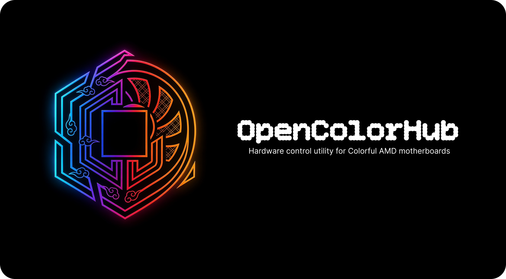
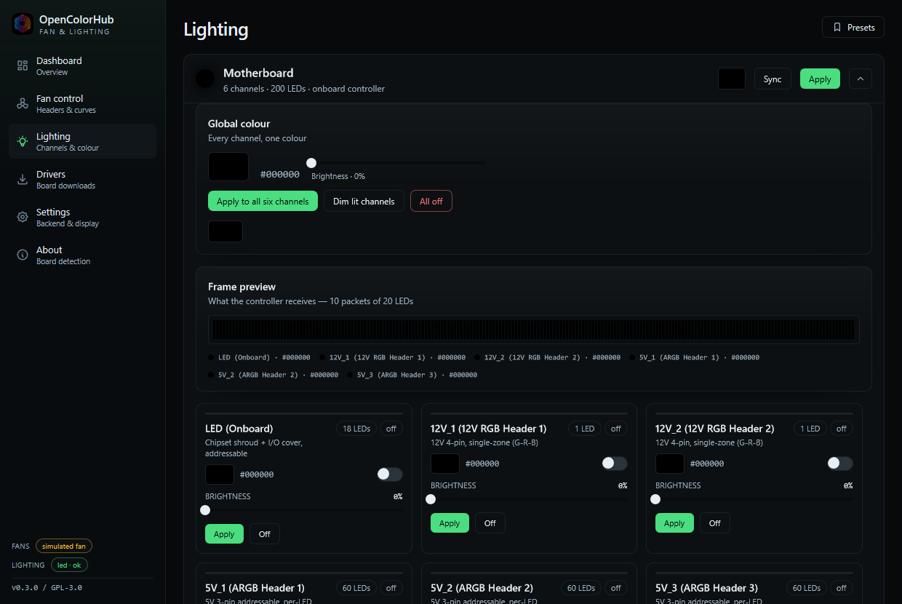

# OpenColorHub



Fan and ARGB control for Colorful AMD motherboards: a Tauri 2 desktop app and a
`colorctl` CLI over one hardware core.

Two blocks: the **Nuvoton Super I/O** (fan headers, 4-point curves, tachometers,
board temperature) and the **Colorful RGB controller** (200 LEDs on six
channels: onboard shroud, two 12V RGB headers, three 5V ARGB headers).

SMBIOS identifies the board before any write, against a verified catalogue; a
non-Colorful machine never has its Super I/O touched.
→ [Board detection](docs/BOARD-DETECTION.md)

A desktop rewrite of [`colorctl`](https://github.com/Curstantine/colorctl):
register programming, curve tables and `CCTL` state stay byte-compatible, so CLI
and app can alternate without losing lighting state.

## Platforms

| Platform | Fans | Lighting |
| --- | --- | --- |
| **Linux** | ✅ `/dev/port` — root or `CAP_SYS_RAWIO` | ✅ `/dev/hidraw` |
| **Windows** | ✅ PawnIO sandboxed driver · ⚪ read-only via HWiNFO without it | ✅ SetupAPI + `hid.dll`, no driver |

Windows needs a signed driver to broker `IN`/`OUT`. PawnIO is **not bundled**: on
launch and from Fan control the app fetches PawnIO's installer from the project's
releases, checks a pinned SHA-256 and runs it, so its UI and UAC prompt appear.
Nothing installs silently. Without it: HWiNFO telemetry, then the simulator, both
labelled. → [Platform notes](docs/PLATFORM.md)

## Screenshots

| | |
| --- | --- |
|  |  |
| **Dashboard** — gauge with session history, six live metrics, fan and channel detail | **Fan control** — per-channel curves, presets |
|  |  |
| **Lighting** — six channels, 200-LED frame | **Drivers** — vendor downloads, nothing executed |
|  | |
| **About** — the board this build detected | |

Settings covers backend, elevation, units, safety confirmations, poll interval,
startup and updates. Fan duties/curves and lighting are saved as an active setup
and re-applied at every launch and after sleep, so a shutdown or restart does not
drop your configuration; the named presets are separate, manual snapshots.
Closing the window hides it to the tray; **Quit** is the only exit; relaunching
brings the running instance forward.

## Install

Windows installers, a portable zip and Linux packages are on the
[releases page](https://github.com/msartore/OpenColorHub/releases). The portable
zip keeps settings and state in `config/` and `data/` beside the executable.

### The `colorctl` CLI

On Debian/Ubuntu:

```bash
sudo apt install ./opencolorhub-cli_*_amd64.deb
```

Installs `colorctl`, bash/zsh/fish completions and the udev rule that lets the
logged-in user drive RGB without root. Portable tarballs (binary + completions)
are on the release page. Syntax matches upstream: `rgb`, `fan`, `board`,
`--backend auto|hardware|simulated`, `--json`.

From source:

```bash
npm install
npm run tauri dev      # hot reload
npm run tauri build    # bundles in target/release/bundle
npm run dev            # browser demo, no Rust toolchain needed
cargo test             # core + CLI unit tests
```

On Windows, `pwsh scripts/build-release.ps1 -Portable` strips absolute source
paths and refuses to package a stale executable. Linux hardware needs privileges:

```bash
sudo ./target/release/opencolorhub        # or set CAP_SYS_RAWIO on the binary
```

## Documentation

| | |
| --- | --- |
| [Architecture](docs/ARCHITECTURE.md) | Crates, backend boundary, protocols, verification |
| [Platform notes](docs/PLATFORM.md) | Driver rationale, fallbacks, elevation, startup, tray |
| [RGB compatibility](docs/RGB-COMPATIBILITY.md) | ODM families, USB PIDs, the 200-LED frame, OpenRGB comparison |
| [GPU LED](docs/GPU-LED.md) | Optional AMD/NVIDIA/Intel GPU RGB over ADL, NVAPI and IGCL at I²C 0x36 |
| [Board detection](docs/BOARD-DETECTION.md) | Confidence levels, sources, the hardware guard |
| [Updates](docs/UPDATES.md) | Self-updater, release process, integrity caveats |
| [Drivers](docs/DRIVERS.md) | Board download catalogue, URL rules, why nothing is executed |
| [Presets](docs/SETUPS.md) | Saved fan and lighting presets, on the screens that own them |
| [NOTICE.md](NOTICE.md) | Licensing of this project and everything it embeds |

## Safety

* **Pump protected** — curves below 60% rejected, manual duty clamped, built-in
  profiles use Colorful's pump table.
* **Curves validated before the chip** — four points, strictly ascending
  temperatures, 0–100% duty, enforced in UI, CLI and service.
* **Chip identified first** — an unrecognised Super I/O aborts before any
  register write (`0xD42A` via `/dev/port`, the `0xD1xx` family via PawnIO).

Writing fan curves on an unverified board is at your own risk.

## Licence

GNU General Public License v3.0 — SPDX `GPL-3.0-only`. Full text in
[`LICENSE.md`](LICENSE.md); practical terms, the MIT attribution for upstream
`colorctl` portions and the LGPL notice for the embedded PawnIO module are in
[`NOTICE.md`](NOTICE.md).

No warranty: this software writes to Super I/O and USB HID hardware, and the
licence says the authors are not liable for damage.
