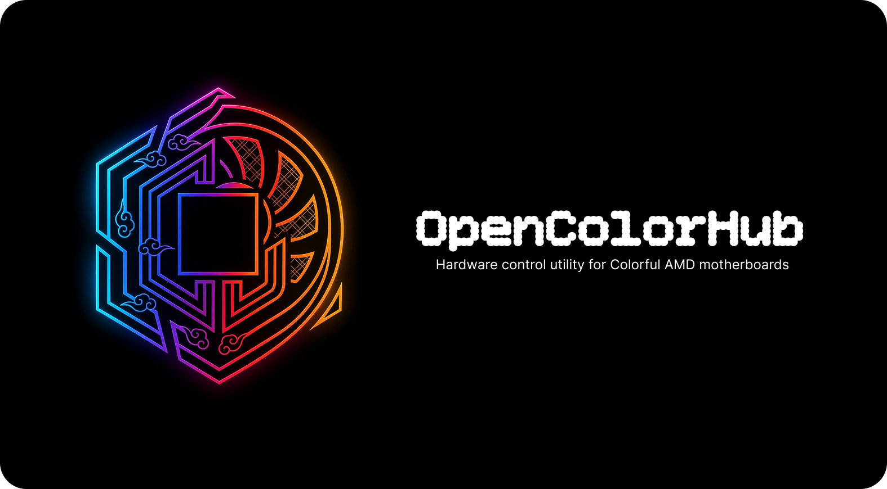
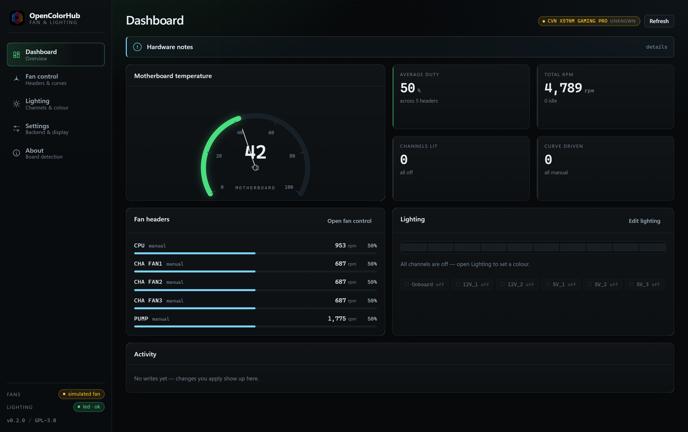
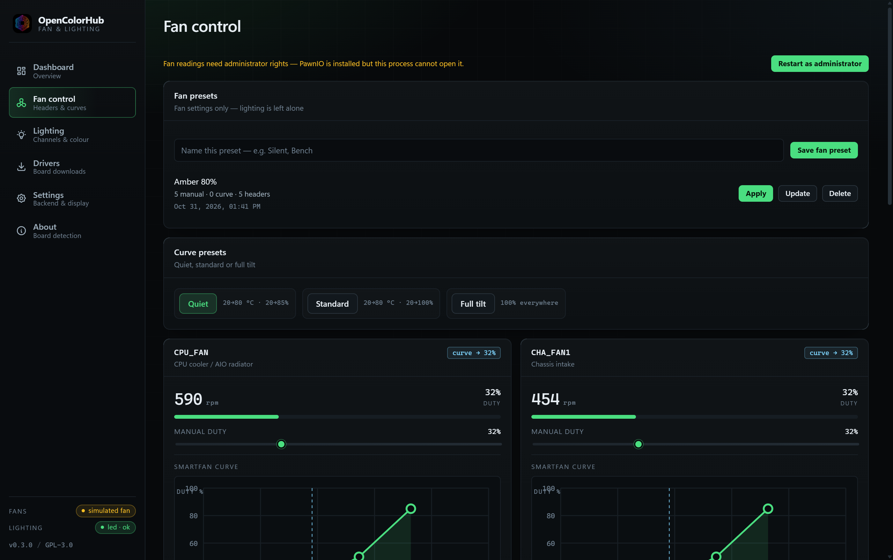
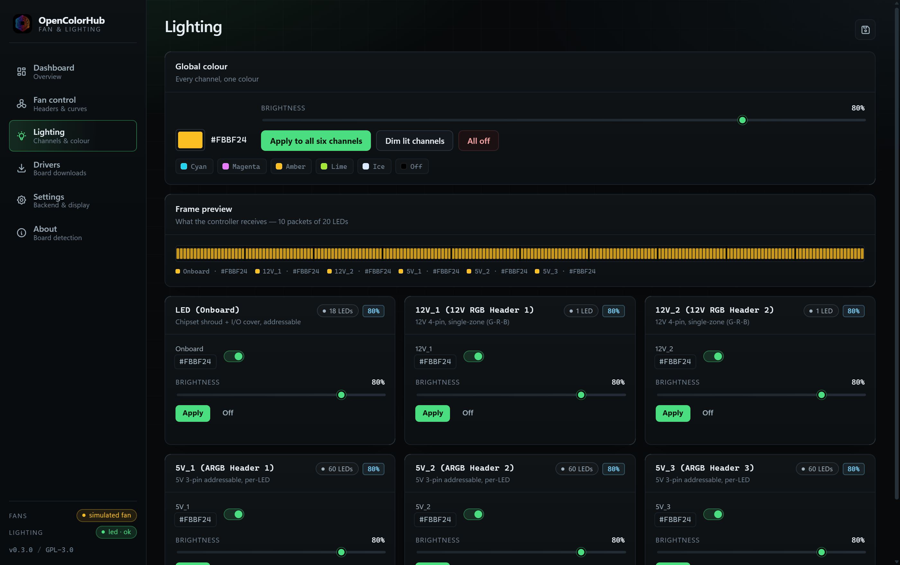
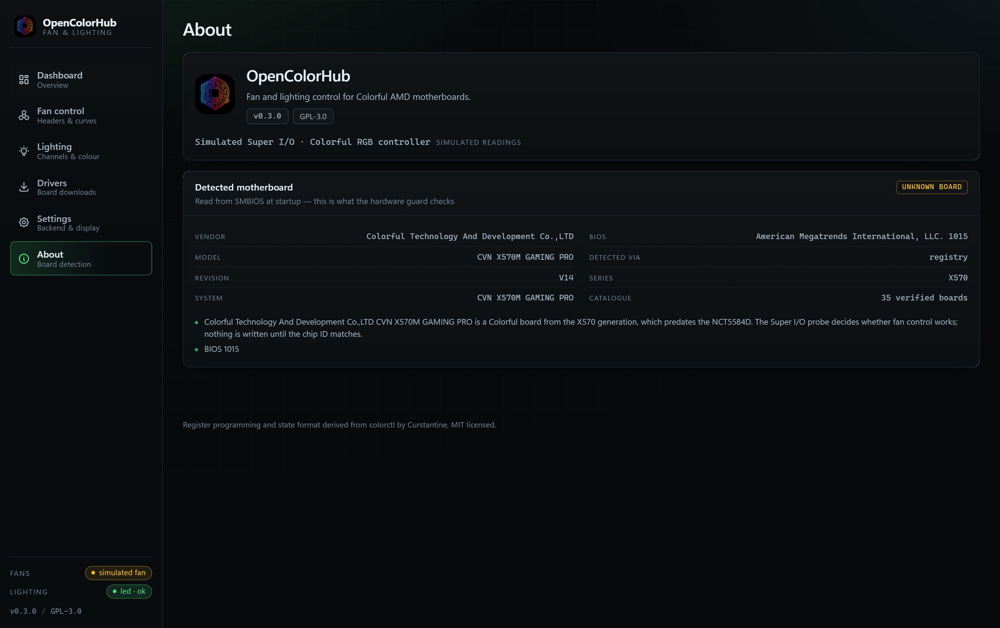

# OpenColorHub



Desktop control for the two hardware blocks every Colorful AMD board ships with:

* **Nuvoton Super I/O** — fan headers, curves, tachometers and board temperature.
  Linux reaches it through `/dev/port` (NCT5584D); Windows uses PawnIO's sandboxed
  driver (NCT6793D / NCT5567D-B, `0xD1xx`).
* **Colorful onboard RGB controller** — 200 LEDs across six channels: onboard
  shroud, two 12V RGB headers, three 5V ARGB headers (via HID `2F4C:1000`).

The board is identified from SMBIOS before anything is written, and matched
against the verified catalogue (35 models). A machine that is not a Colorful
board never gets its Super I/O touched.

This is a desktop rewrite of [`colorctl`](https://github.com/Curstantine/colorctl)
by Curstantine. The register programming, curve tables and the `CCTL` state
format are kept byte-compatible with upstream, so a machine can switch between
the CLI and this app without losing its lighting state. What is new is the
multi-platform structure: a hardware-agnostic core crate, a Tauri 2 desktop
shell, a cross-platform simulator, and the CLI rebuilt on the same core.

```
┌──────────────────────────────────────────────────────────────┐
│  crates/colorctl-core     model · curves · state · service   │
│      ├── backend/linux      /dev/port + /dev/hidraw           │
│      ├── backend/windows    SetupAPI + hid.dll (lighting)     │
│      └── backend/sim        works everywhere (CI, demos)      │
├──────────────────────────────────────────────────────────────┤
│  crates/colorctl-cli      `OpenColorHub` binary (upstream syntax)│
│  src-tauri/               Tauri 2 shell + IPC commands        │
│  src/                     TypeScript UI (no framework)        │
└──────────────────────────────────────────────────────────────┘
```

## Board auto-detection

Every screen shows which board it thinks it is talking to, and how sure it is:

| Confidence | Meaning | Hardware probe |
| --- | --- | --- |
| **verified** | exact match in the 35-model catalogue | allowed |
| **compatible** | Colorful board of a known generation, not catalogued | allowed, with a caution note |
| **unknown** | identity unreadable, or a Colorful chipset outside the catalogue (X570, B550, …) | allowed — the chip-ID check decides |
| **unsupported** | another vendor (ASUS, MSI, ASRock, …) | **blocked** in `auto` mode |

Sources: `/sys/class/dmi/id/*` on Linux and `HKLM\HARDWARE\DESCRIPTION\System\BIOS`
on Windows. Other platforms report `none`. The verdict is in every telemetry snapshot
(`snapshot.board`), on the Dashboard header, in Settings, on the About screen,
and in `colorctl board`:

```console
$ colorctl board
Motherboard: Colorful Technology And Development Co.,LTD CVN X570M GAMING PRO
  Board rev:   V14
  BIOS: American Megatrends International, LLC. 1015
  System:      CVN X570M GAMING PRO
  Detected by: registry
  Support: UNKNOWN (35 of 35 catalogue boards)
  · ... is a Colorful board from the X570 generation, which predates the
    NCT5584D. The Super I/O probe decides whether fan control works; nothing is
    written until the chip ID matches.
  · BIOS 1015
  Hardware: Super I/O probe decides at runtime
```

That board is not in the catalogue, so it reads `UNKNOWN` — and fan control still
works, because the Super I/O on this X570 board (`0xD121`) answers the probe. The
confidence level gates *policy*, not capability.

The guard is deliberately conservative in one direction only: it refuses
hardware when the board is *known* to be someone else's, and stays out of the
way when it simply does not know. `--backend hardware` overrides the guard for
people who know what they are doing.

## Screens

| Screen | What it does |
| --- | --- |
| **Dashboard** | Live temperature gauge, average duty, tachometers, lighting preview, activity feed |
| **Fan control** | Per-header manual duty (0–100%), draggable 4-point curve editor, Quiet/Standard/Full presets, pump floor |
| **Lighting** | Per-channel colour + brightness + on/off, global colour, 200-LED frame preview |
| **Settings** | Backend (`auto`/`hardware`/`simulated`), detected board, poll interval, units, accent, safety confirmations, paths |
| **About** | Detected board: vendor, model, revision, BIOS and the confidence verdict |

Everything is verified against real execution: `cargo test` covers the core, the
browser demo exercises the whole UI over CDP, and the desktop binary has been
driven against real hardware on Windows — RGB over HID and fan RPM/duty through
PawnIO on a CVN X570M GAMING PRO V14.

## Screenshots

Taken from the running desktop app (Windows, unelevated so fans fall back to the
simulator, real board detection — this machine reports a CVN X570M GAMING PRO V14,
in the catalogue as `unknown` because it predates the B650-era boards):

| | |
| --- | --- |
|  |  |
| **Dashboard** — gauge, duty, tachometers, lighting preview | **Fan control** — per-header curves, presets, pump floor |
|  |  |
| **Lighting** — six channels, 200-LED frame preview | **About** — the board this build detected |

## Updates

On launch the app asks GitHub for the newest release. If the tag is higher than
the running build it offers the update in a dialog; accepting downloads the
release's `OpenColorHub.exe`, checks it against `SHA256SUMS.txt` from the same
release, swaps it in and restarts. **Settings → Updates → Check now** forces a
check on demand.

How the swap works, and why it is not the Tauri updater plugin:

* Windows refuses to overwrite a running image but allows *renaming* it. The
  app moves itself to `OpenColorHub.old.exe`, copies the download into place,
  restarts, and deletes the leftover on the next launch. A failed copy rolls the
  rename back, so a broken update leaves a working app instead of none.
* No signing keys, no `latest.json`, no installer re-run — the release already
  publishes the bare executable as an asset, which is what the updater fetches.
* The download is verified against `SHA256SUMS.txt` over HTTPS. These builds are
  **not Authenticode signed**, so integrity rests on GitHub's TLS and that
  checksum, not on a vendor certificate.

Nothing updates without the dialog being accepted.

## Requirements

| Platform | Fan control | Lighting | Notes |
| --- | --- | --- | --- |
| Linux | ✅ `/dev/port` (root or `CAP_SYS_RAWIO`) | ✅ `/dev/hidraw` for `2F4C:1000` | full functionality |
| Windows | ✅ PawnIO sandboxed driver · ⚪ read-only via HWiNFO when PawnIO is absent | ✅ SetupAPI + `hid.dll`, no driver | `IN`/`OUT` are ring-0; PawnIO brokers them through a signed, allow-listed module |

macOS is not supported and not shipped. Board detection reads SMBIOS or the
Windows registry only; there is no hardware path for it.

`IN`/`OUT` are ring-0 instructions — Windows ships no `/dev/port` equivalent, so
user-mode code cannot touch a Super I/O directly. The alternatives are a kernel
driver of your own, [WinRing0](https://nvd.nist.gov/vuln/detail/CVE-2020-14979)
(which this project will not ship — see `NOTICE.md`), or **PawnIO**: a signed
driver that executes a bytecode module whose port access is allow-listed to the
selected index pair and discovered BARs, and never exposes physical memory.
This app talks to it through `PawnIOLib.dll`, with the LpcIO module embedded.

PawnIO is **not bundled** — install it separately (the LibreHardwareMonitor
installer ships it). Without it the app falls back to HWiNFO, then the simulator.

Fan curves on Windows are evaluated **in software**: the manual-duty registers are
mapped for this chip, the SmartFan curve registers are not. A curve therefore
lives as long as the process does, and manual duty stays as last written after
the app exits until the BIOS resets it.

Lighting needs no privileged access — the RGB controller is an ordinary USB HID
device — so the Windows backend talks to it directly through SetupAPI and
`hid.dll`, with no driver, no service and no elevation.

`colorctl rgb probe` shows what the HID layer finds on a Windows host:

```
Colorful HID interfaces (VID 2F4C, PID 1000):
  MI_02  usage page 0xFF01  out  65  feat   0  <= selected  [COLORFUL]
        \\?\hid#vid_2f4c&pid_1000&mi_02#<instance>#{4d1e55b2-f16f-11cf-88cb-001111000030}
  MI_01  usage page 0xFF00  out  65  feat   0  [X570-USBHID-LED]
        \\?\hid#vid_2f4c&pid_1000&mi_01#<instance>#{4d1e55b2-f16f-11cf-88cb-001111000030}
```

MI_02 (`0xFF01`) carries LED frames. MI_01 (`0xFF00`) is the firmware-update
collection — same VID/PID, different usage page, never written to. If a firmware
revision expects feature reports instead of output reports, set
`OPENCOLORHUB_HID_TRANSPORT=feature`; the backend falls back automatically when
the output-report write fails.

### Windows fan backends

The Windows backend tries them in order and reports which one it got:

1. **PawnIO** — real RPM, real board temperature, real manual duty. Requires the
   driver installed and the app running elevated.
2. **HWiNFO shared memory** — read-only. Needs HWiNFO64 running with
   *Settings → Safety → Shared Memory Support* on. Two header layouts exist in
   the wild (`__time64_t` packed or 8-byte aligned) and both are detected from
   the block itself, so a version bump does not silently break it.
   `OPENCOLORHUB_HWINFO_SHM` points the reader at a non-standard section name.
3. **Simulator** — persists state, evaluates curves and enforces the pump floor,
   so the app is fully usable anywhere.

To exercise the HWiNFO reader without HWiNFO installed, publish a synthetic block:

```bash
cargo run -p colorctl-core --example hwinfo_standin   # holds the section open
colorctl fan status                                   # reads it
```

### Elevation

The Windows build carries a manifest requesting `requireAdministrator`, so
Windows raises its own UAC prompt before the process starts — every launch asks,
and declining means the app does not run. There is no silent path and nothing is
persisted.

Elevation is what makes PawnIO fan control work: `pawnio_open` returns
`ERROR_ACCESS_DENIED` to an unelevated process. The RGB and HWiNFO paths do not
need it, so an unelevated build still drives lighting and still reads sensors
when HWiNFO is running — it just cannot touch the Super I/O.

Settings → Privileges shows the current state and offers a one-shot
*Restart as administrator*. Builds that already carry the manifest never show
that button, because they can never be running unelevated.

This is deliberately the visible path. Some vendor utilities instead register a
hidden scheduled task with `RunLevel::Highest` and rewrite their shortcuts, which
gets administrator rights on every launch with no consent dialog — the elevation
half of the iGC.Lite findings. This app will not do that: one prompt, one
decision, nothing persisted.

Trade-off worth knowing: requiring elevation means the portable build also
prompts for UAC, and the app cannot be started at login by a normal shortcut.
If that is unwanted, delete `src-tauri/app.manifest`, revert `build.rs` to
`tauri_build::build()`, and the app falls back to `asInvoker` with the on-demand
button — at the cost of Windows fan control, which then degrades to HWiNFO or
the simulator.

### Start with the OS

**Settings → Startup** registers a sign-in entry for the current user:

* **Windows** — a Task Scheduler logon task named `OpenColorHub` with
  `RunLevel Highest`. A `HKCU\...\Run` value would be simpler, but those start
  the process unelevated, which for this app means no fan control and a UAC
  prompt at every sign-in anyway.
* **Linux** — an XDG autostart entry at
  `${XDG_CONFIG_HOME:-~/.config}/autostart/opencolorhub.desktop`.

Turning the switch off deletes the entry. It is created only when you ask for
it, named plainly in Task Scheduler, and removed by the same switch — unlike the
vendor pattern this project rejects, where installation itself plants a hidden
highest-privilege task.

Enabling it also turns on **Re-apply lighting at launch**, so the saved `CCTL`
state is pushed to the controller at sign-in. Without that the app would start
and leave the lighting dark, which is not what "start with the OS" should mean.

### Tray

OpenColorHub installs a tray icon at startup. Closing the window **hides** it
rather than quitting — the app keeps polling and keeps the lighting as you set
it — and the window comes back from the tray icon (left click) or its
**Open OpenColorHub** menu entry. **Quit** is the only thing that really exits.

A launch from the autostart entry passes `--minimized`, so signing in drops the
icon into the tray and shows no window at all. Opening the app yourself still
brings the window up normally.

## Run it

```bash
npm install            # frontend dependencies

npm run tauri dev      # desktop app with hot reload
npm run tauri build    # installers in src-tauri/target/release/bundle
pwsh scripts/build-release.ps1 -Portable   # stripped paths + zip (see below)
npm run dev            # browser-only demo (simulated backend, no Rust needed)
cargo test             # core + CLI + shell unit tests
cargo run -p opencolorhub-cli -- fan status --backend simulated
```

Windows packages land in `target/release/bundle/` (NSIS, MSI) and
`bundle/portable/` (zip).

Rust embeds absolute source locations in panic messages, so a plain
`tauri build` puts your home directory inside the executable
(`C:\Users\<you>\…`). `scripts/build-release.ps1` derives
`--remap-path-prefix` from the environment and strips them, and the release
workflow does the same. Cargo's `trim-paths` would be the clean fix but is still
unstable in Cargo 1.99.

On Linux, real hardware needs privileges:

```bash
sudo ./target/release/opencolorhub        # or set CAP_SYS_RAWIO on the binary
# lighting writes only need access to the hidraw node
```

## CLI

The `colorctl` binary keeps the upstream command syntax, plus `--backend`,
`--json` and a `board` subcommand:

```bash
colorctl rgb status
colorctl rgb set --color '#ff0088' --brightness 60 --channel 5v_1,led
colorctl rgb off --channel led

colorctl fan status
colorctl fan set-speed  --fan cpu --percent 60
colorctl fan set-speed  --fan all --pwm 180
colorctl fan set-curve  --fan cpu --points 30:25,50:45,70:75,85:100
colorctl fan set-curve  --fan all --profile quiet
colorctl board
colorctl completions bash
```

`--backend simulated` runs everything without touching hardware, which is how
the CLI is tested on Windows CI.

## Safety

* **The pump is protected.** Curves that drop below 60% are rejected, manual
  duty is clamped at 60%, and the built-in profiles use Colorful's pump table.
* **Curves are validated before they reach the chip.** Four points, strictly
  ascending temperatures, 0–100% duty; the same validation runs in the UI, the
  CLI and the service.
* **The chip is identified first.** An unrecognised Super I/O aborts before any
  register write — `0xD42A` on the Linux `/dev/port` path, the `0xD1xx` family on
  the Windows PawnIO path.
* **Nothing is silently simulated.** If hardware is missing the sidebar says
  which backend is live, the dashboard shows a one-line notice you can expand,
  and Settings names the fallback and the reason.

Writing fan curves on a board you have not verified is at your own risk.

## Supported hardware

Two different Super I/O families are in play, which is why the README never
promises a single chip:

* **B650 / B840 / B850 / X870** boards ship the **NCT5584D** (`0xD42A`) and are
  what upstream verified, including the CVN B650M Gaming Frozen V14.
* The **CVN X570M Gaming PRO V14** in this repository is older and carries a
  **`0xD121`** (NCT6793D / NCT5567D-B family). Its fan registers were mapped by
  probing this board, not from a vendor document.

Lighting is the common denominator: every one of these boards exposes the same
Colorful RGB controller as HID `2F4C:1000` on usage page `0xFF01`.

## Repository layout

```
crates/colorctl-core   hardware model, curves, CCTL state, settings, backends,
                       board guard, elevation, PawnIO + HWiNFO readers
crates/colorctl-cli    clap CLI on top of the core
src-tauri/             Tauri commands, telemetry ticker, self-updater, manifest
src/                   TypeScript UI: views, components, demo backend
scripts/               icon pipeline, portable packaging
docs/ARCHITECTURE.md   layering, protocols, update path, verification
docs/assets            README banner
.github/workflows      ci.yml (branches) · release.yml (tags)
```

## Licence

GNU General Public License v3.0 — SPDX `GPL-3.0-only`. You may use, modify and
redistribute this software, provided the complete corresponding source stays
available under the same licence and the notices are preserved. Full text in
[`LICENSE.md`](LICENSE.md); what that means in practice is in
[`NOTICE.md`](NOTICE.md).

`colorctl` by Curstantine is MIT-licensed, and this rewrite derives from it. The
MIT notice for those portions is retained in `NOTICE.md` and shown on the About
screen alongside the GPL identifier — which is what "copyright and licence
notices must be preserved" requires of a combined work.

The software comes with no warranty, including the implied warranties of
merchantability or fitness for a particular purpose. It writes to Super I/O and
USB HID hardware; if that damages anything, the licence says the authors are not
liable, and you accepted that by running it.
