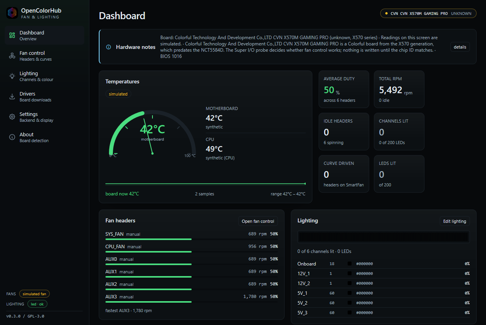
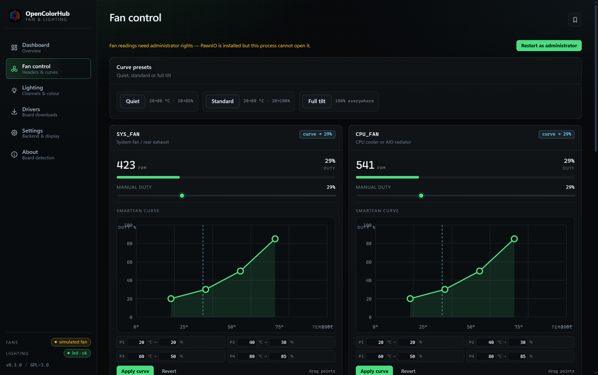
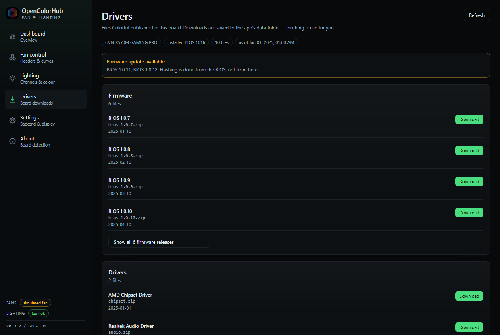
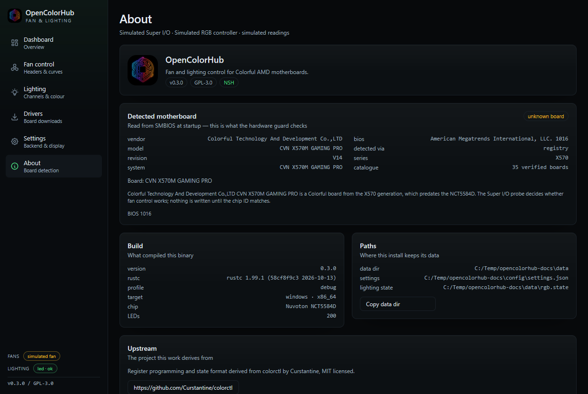

# OpenColorHub

Fan and ARGB control for Colorful AMD motherboards: a Native Shell desktop app
and a `colorctl` CLI over one hardware core.

Two blocks: the **Nuvoton Super I/O** (fan headers, 4-point curves, tachometers,
board temperature) and the **Colorful RGB controller** (200 LEDs on six
channels: onboard shroud, two 12V RGB headers, three 5V ARGB headers).

SMBIOS identifies the board before any write, against a verified catalogue; a
non-Colorful machine never has its Super I/O touched.
→ [Board detection](docs/BOARD-DETECTION.md)

A desktop rewrite of [`colorctl`](https://github.com/Curstantine/colorctl):
register programming, curve tables and `CCTL` state stay byte-compatible, so CLI
and app can alternate without losing lighting state.

The desktop app is built with [Native Shell](https://nsh.dev): native windows on
Windows and Linux, no WebView and no Tauri.

**Two temperatures, one sensor bus.** The dashboard shows the board thermistor
(Nuvoton bank 1 `0x50`) and the CPU die temperature from `CPUTIN` (bank 0 `0x75`)
over the same PawnIO connection — no HWiNFO needed. Every fan curve follows the
board sensor except `CPU_FAN`, which follows the CPU sensor. Each header falls
back to the other reading when its own is unavailable, so a missing CPU reading
never stops the CPU fan. HWiNFO shared memory remains a read-only fallback for
boards that leave CPUTIN unwired. → [Platform notes](docs/PLATFORM.md)

## Screenshots

Captured from the Native Shell app in simulated mode (no hardware is touched),
so the board data shown is synthetic.

| Dashboard | Fan control | Lighting |
| --- | --- | --- |
|  |  |  |

| Drivers | About |
| --- | --- |
|  |  |

## Platforms

| Platform | Fans | Lighting |
| --- | --- | --- |
| **Linux** | ✅ `/dev/port` — root or `CAP_SYS_RAWIO` | ✅ `/dev/hidraw` |
| **Windows** | ✅ PawnIO sandboxed driver; HWiNFO shared memory read-only without it | ✅ SetupAPI + `hid.dll`, no driver |

Windows needs a signed driver to broker `IN`/`OUT`. PawnIO is **not bundled**, and
the app never updates it: on demand it fetches PawnIO's installer from the
project's releases, checks a pinned SHA-256 and runs it, so its UI and UAC prompt
appear. Nothing installs silently. A newer component version ships with a new
release of this app, which bumps the pin. Without PawnIO: HWiNFO telemetry, then
the simulator, both labelled. → [Platform notes](docs/PLATFORM.md) ·
[Updates](docs/UPDATES.md)

The desktop installer is per-user and does not request administrator. When PawnIO
is installed but the process cannot open it, the app asks before restarting
elevated; declining leaves the app running for lighting, settings and telemetry.

## Install

Windows installers, portable zips and Linux tarballs are on the
[releases page](https://github.com/msartore/OpenColorHub/releases). The app also
ships `latest.json`, so updates are checked and installed from inside Settings.
Only the app updates itself: components such as the PawnIO driver stay pinned to
the release and are never replaced in place.

The portable build keeps settings and state in `config/` and `data/` beside the
executable.

### The `colorctl` CLI

On Debian/Ubuntu:

```bash
sudo apt install ./opencolorhub-cli_*_amd64.deb
```

Installs `colorctl`, bash/zsh/fish completions and the udev rule that lets the
logged-in user drive RGB without root. Portable tarballs (binary + completions)
are on the release page. Syntax matches upstream: `rgb`, `fan`, `board`,
`--backend auto|hardware|simulated`, `--json`.

## Build from source

The desktop app lives in [`nsh/`](nsh/README.md) and needs the `nsh` toolchain:

```bash
curl -fsSL https://nsh.dev/install.sh | sh        # Windows: irm https://nsh.dev/install.ps1 | iex
nsh check nsh
nsh build nsh
OPENCOLORHUB_SIM=1 nsh test nsh                   # simulator, no hardware
nsh run nsh
nsh package nsh --target windows                  # or linux
```

The core and CLI are ordinary Cargo crates:

```bash
cargo test --workspace
cargo build --release -p opencolorhub-cli
```

Linux hardware needs privileges:

```bash
sudo ./target/release/colorctl fan --header cpu --percent 50
```

## Documentation

| | |
| --- | --- |
| [Architecture](docs/ARCHITECTURE.md) | Crates, the NSH seam, backend boundary, protocols, verification |
| [Platform notes](docs/PLATFORM.md) | Driver rationale, fallbacks, elevation, startup, tray |
| [RGB compatibility](docs/RGB-COMPATIBILITY.md) | ODM families, USB PIDs, the 200-LED frame, OpenRGB comparison |
| [Board detection](docs/BOARD-DETECTION.md) | Confidence levels, sources, the hardware guard |
| [Updates](docs/UPDATES.md) | `nsh/updater`, pinned components, release process, integrity caveats |
| [Drivers](docs/DRIVERS.md) | Board download catalogue, verified downloads with progress, why nothing is executed |
| [Presets](docs/SETUPS.md) | Saved fan and lighting presets, on the screens that own them |
| [MIGRATION.md](MIGRATION.md) | The Tauri → Native Shell conversion record |
| [NOTICE.md](NOTICE.md) | Licensing of this project and everything it embeds |

## Safety

* **Pump protected** — curves below 60% rejected, manual duty clamped, built-in
  profiles use Colorful's pump table.
* **Curves validated before the chip** — four points, strictly ascending
  temperatures, 0–100% duty, enforced in UI, CLI and service.
* **Chip identified first** — an unrecognised Super I/O aborts before any
  register write (`0xD42A` via `/dev/port`, the `0xD1xx` family via PawnIO).

Writing fan curves on an unverified board is at your own risk.

## Licence

GNU General Public License v3.0 — SPDX `GPL-3.0-only`. Full text in
[`LICENSE.md`](LICENSE.md); practical terms and the attributions for upstream
`colorctl` (MIT), Tabler icons (MIT), the embedded PawnIO module (LGPL-2.1+) and
the OpenRGB-derived GPU protocol facts (GPL-2.0+) are in [`NOTICE.md`](NOTICE.md).

No warranty: this software writes to Super I/O and USB HID hardware, and the
licence says the authors are not liable for damage.
